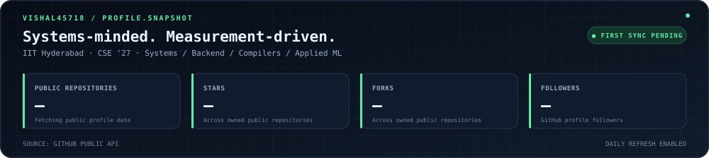

<!--
  Vishal Varukolu — GitHub Profile README
  Live profile snapshot: assets/profile-dashboard.svg
  Generator: scripts/generate_profile_dashboard.py
  Schedule:  .github/workflows/profile-dashboard.yml
  Images in assets/: IITH.png, contact-cat.png, cat_1.png
  Badge palette: background 172033, logo/accent 67E8A5 (matches the dashboard)
-->

# Vishal Varukolu

**CSE @ IIT Hyderabad · Class of 2027**

`systems` · `backend infrastructure` · `compilers` · `applied ML`

 

<code>vishal@iith:~$ ./profile --snapshot</code> · public GitHub metrics · refreshed daily

---

## `01 / whoami`

I like working close to the metal and tracing problems across the stack, from compiler passes and data structures to distributed services and GPU training systems.

| | |
|:--|:--|
| **Currently building** | Tools for reasoning about failures in distributed training |
| **Engineering philosophy** | Small, testable components; explicit trade-offs; measurements over unbenchmarked claims of scale |

---

## `02 / selected-work`

### TrainPulse
*Research · Distributed training observability*

Co-developed a lightweight fault-localization pipeline for multi-node LLM training. It combines iteration-time change detection, component-level anomaly scores, and dependency-aware reasoning to narrow down likely sources of fail-slow behavior.

- **100% single-fault localization accuracy**
- **Under 1% runtime overhead**, compared with **2.18%** for the PyTorch profiler
- Evaluated on a **4-node cluster** fine-tuning **Llama 3 8B**

**Stack:** `Python` · `PyTorch DDP` · `Distributed GPU training`

> Under submission to ACM SIGMETRICS 2027. The research code is not public yet; contact me for details.

### [LAOP Compiler](https://github.com/Vishal45718/LAOP-compiler)
*Compiler backend*

A domain-specific compiler for linear-algebra expressions. The backend performs semantic checks and emits Eigen-based C++ code, with matrix-chain ordering as an optimization pass.

**Stack:** `C++` · `Eigen`

### [Self-Healing RAG](https://github.com/Vishal45718/Self_Healing_RAG)
*Retrieval and evaluation*

A RAG pipeline that can critique its own response path: reformulate a query, retry grounded generation, or abstain when the evidence is weak. Includes an evaluation harness for comparison against baseline retrieval.

**Stack:** `Python` · `LangGraph` · `ChromaDB` · `Sentence Transformers`

### [Scalable Recommendation System](https://github.com/Vishal45718/Scalable_Recommendation_System)
*Backend and data infrastructure*

An event-driven recommendation-system project exploring Kafka ingestion, vector retrieval with FAISS, and a Redis-backed feature cache.

**Stack:** `FastAPI` · `Kafka` · `FAISS` · `Redis` · `PostgreSQL`

### [Inventory Management System](https://github.com/Vishal45718/IMS_Full-Stack-Inventory-Management-System)
*Full-stack web application*

A multi-branch inventory application with REST APIs, JWT authentication, role-based access, and relational data constraints around stock and orders.

**Stack:** `Go` · `Gin` · `MySQL` · `Next.js`

---

## `03 / toolchain`

**Languages** 

**Systems and infrastructure** 

**Machine learning** 

---

## `04 / elsewhere`

**Problem solving:** 500+ DSA problems solved on LeetCode

  

<strong>Operator standing by.</strong> Happy to talk systems, infrastructure, compilers, and applied ML.

---

<code>exit 0</code> · Thanks for visiting my corner of GitHub.

<code>principle.txt</code> · I prefer understanding why a system behaves the way it does, not just making it run.

